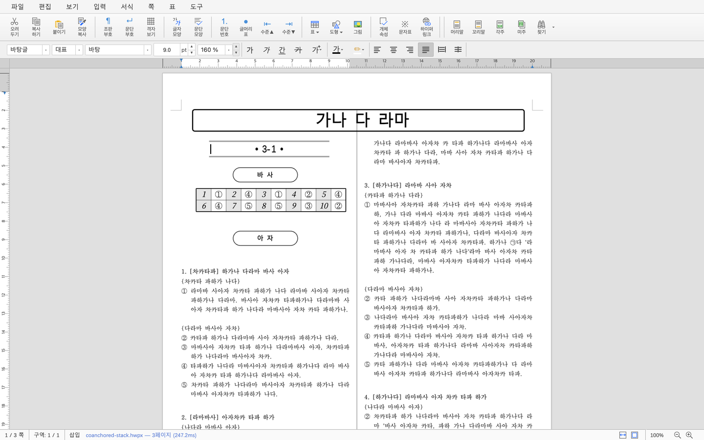
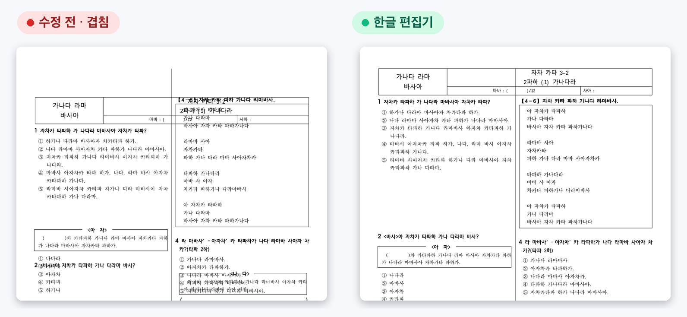
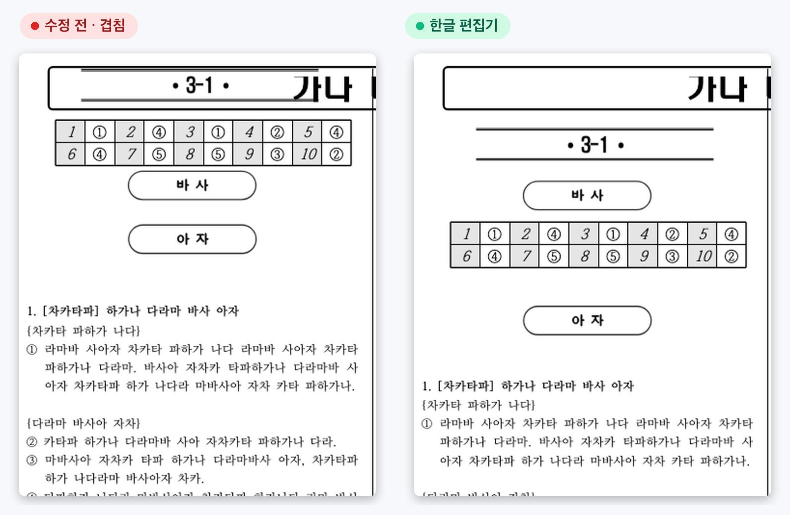
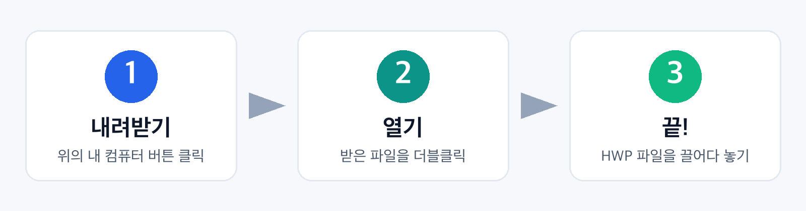

<div align="center">


# 한글 편집기

**HWP · HWPX 문서를 보고 고치는 무료 편집기**

<a href="https://github.com/zoo3323/hangul-editor/releases/latest/download/hangul-editor-macos-arm64.dmg"></a>
<a href="https://github.com/zoo3323/hangul-editor/releases/latest/download/hangul-editor-macos-x64.dmg"></a>
<a href="https://github.com/zoo3323/hangul-editor/releases/latest/download/hangul-editor-windows-x64-setup.exe"></a>
<a href="https://github.com/zoo3323/hangul-editor/releases/latest/download/hangul-editor-linux-x64.deb"></a>



</div>

## ✨ 시험지가 겹치지 않아요




## 📥 설치



**한 줄로 설치** — 복사해서 붙여넣기만 하면 됩니다.

🍎 macOS · 터미널

```sh
curl -fsSL https://raw.githubusercontent.com/zoo3323/hangul-editor/main/install/install-mac.sh | bash
```

🪟 Windows · PowerShell

```powershell
irm https://raw.githubusercontent.com/zoo3323/hangul-editor/main/install/install-windows.ps1 | iex
```

🐧 Linux · 터미널

```sh
curl -fsSL https://raw.githubusercontent.com/zoo3323/hangul-editor/main/install/install-linux.sh | bash
```

<details>
<summary>⚠️ 처음 열 때 경고가 나오면</summary>

| | 이렇게 하세요 |
| --- | --- |
| 🍎 macOS | **시스템 설정 → 개인정보 보호 및 보안 → 그래도 열기** |
| 🪟 Windows | **추가 정보 → 실행** |

개인이 만든 무료 앱이라 유료 인증서가 없어 한 번 나오는 경고입니다. 한 줄 설치를 쓰면 나오지 않습니다.
</details>

## ✅ 할 수 있는 것

| 📂 열기 | ✏️ 편집 | 💾 HWP 저장 | 📄 PDF | 🖨️ 인쇄 | 🔗 링크 |
| :---: | :---: | :---: | :---: | :---: | :---: |
| HWP · HWPX | 글자 · 표 · 그림 | 원본 형식 그대로 | 내보내기 | 바로 인쇄 | 브라우저로 열기 |

<details>
<summary>🔧 고친 것</summary>

| | |
| --- | --- |
| 🧾 2단 시험지 | 머리 표·`<보기>` 상자·해설지 머리 개체가 겹치던 문제 |
| 💥 멈춤 | 쪽 배치 중 앱이 멈추던 문제 (rhwp PR #8286) |
| 💾 저장 | HWP 저장 때 도형 설명이 사라지던 문제 (rhwp #8225) |
| 📑 머리말 | 틀을 넘친 머리말 문단이 사라지던 문제 (rhwp PR #8293) |
| 📊 표 안의 표 | 줄·칸 편집이 바깥 표를 망가뜨리던 문제를 막음 (rhwp #8138) |
| 🔤 글꼴 목록 | 툴바 글꼴 목록이 열리지 않던 문제 (HOP #106) |
| 🔗 링크 | 하이퍼링크가 "팝업 차단"으로 막히던 문제 (HOP #111) |

엔진 수정은 [`patches/rhwp/`](patches/rhwp), 원래 HOP 설명은 [`docs/HOP-README.md`](docs/HOP-README.md)에 있습니다.
</details>

<details>
<summary>🛠️ 직접 빌드</summary>

필요한 것: rustup(`wasm32-unknown-unknown`), wasm-pack 0.15, Node 22+, pnpm 10

```sh
scripts/build-hangul-editor.sh
```

설치 파일은 `v*` 태그를 올리면 [GitHub Actions](.github/workflows/release.yml)가 macOS·Windows·Linux 용으로 만듭니다.
</details>

<div align="center">
<sub>
<a href="https://github.com/golbin/hop">HOP</a>와 <a href="https://github.com/edwardkim/rhwp">rhwp</a>(모두 MIT)를 바탕으로 만든 개인 프로젝트입니다 · 한글과컴퓨터와 관계없습니다
</sub>
</div>
