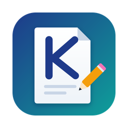
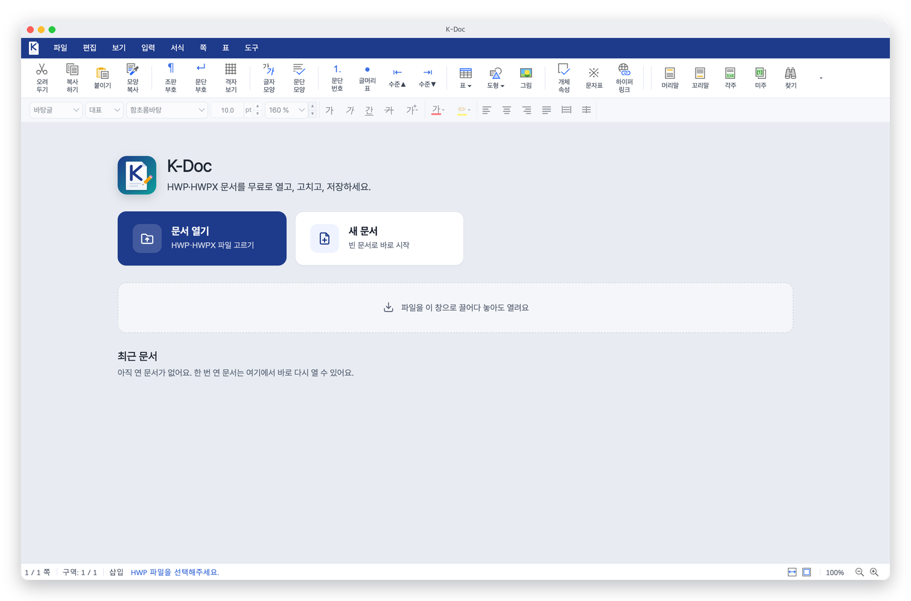
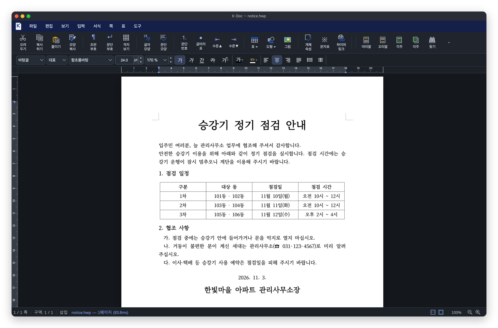
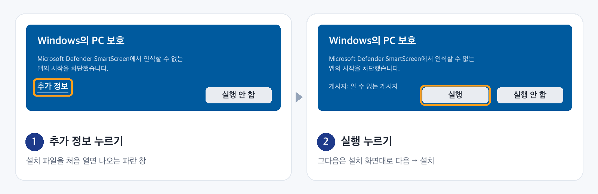

<div align="center">



# K-Doc

### 한글 문서(HWP·HWPX)를 **무료로** 열고 고치세요


<br><br>

**👇 내 컴퓨터에 맞는 버튼을 누르세요**

<a href="#mac-설치"></a>
<a href="https://github.com/zoo3323/k-doc/releases/latest/download/k-doc-windows-x64-setup.exe"></a>
<a href="https://github.com/zoo3323/k-doc/releases/latest/download/k-doc-linux-x64.deb"></a>

<sub>Mac은 버튼 대신 아래 <a href="#mac-설치">한 줄 설치</a>를 쓰세요. Apple 칩·인텔은 알아서 맞춥니다.</sub>


</div>

## 💸 한컴오피스가 없어도 됩니다

| 💰 | 🚫 | 🙅 | 📴 |
| :---: | :---: | :---: | :---: |
| **0원** | **광고 없음** | **가입 없음** | **인터넷 없이** |
| 완전 무료 | 깨끗한 화면 | 설치하면 끝 | 내 컴퓨터에서만 |

<table>
<tr>
<td width="50%"></td>
<td width="50%"></td>
</tr>
<tr>
<td align="center">시작 화면</td>
<td align="center">어두운 화면</td>
</tr>
</table>

<a id="설치"></a>

## 📥 설치

<a id="mac-설치"></a>

### 🍎 macOS: 터미널에 한 줄

1. **⌘ + 스페이스**를 누르고 `터미널`을 입력한 뒤 **Enter**
2. 아래 한 줄을 복사해 붙여 넣고 **Enter**

```sh
curl -fsSL https://raw.githubusercontent.com/zoo3323/k-doc/main/install/install-mac.sh | bash
```

끝나면 K-Doc이 바로 열립니다. 경고 창도, 비밀번호 입력도 없습니다. 새 버전이 나오면 같은 줄을 다시 실행하면 업데이트됩니다.

### 🪟 Windows · 🐧 Linux


| | 받은 파일 | 이렇게 하세요 |
| :---: | --- | --- |
| 🪟 | `-setup.exe` | 더블클릭 → **설치** |
| 🐧 | `.deb` | 더블클릭 → **설치** |

**🪟 Windows에서 처음 열 때 경고가 나오면**

개인이 만든 무료 앱이라 유료 인증서가 없어서 **처음 한 번만** 나옵니다.



<details>
<summary>⌨️ Windows·Linux도 한 줄 설치 (경고 없음)</summary>

🪟 Windows · PowerShell

```powershell
irm https://raw.githubusercontent.com/zoo3323/k-doc/main/install/install-windows.ps1 | iex
```

🐧 Linux

```sh
curl -fsSL https://raw.githubusercontent.com/zoo3323/k-doc/main/install/install-linux.sh | bash
```
</details>

## 🛠️ HOP·rhwp의 문제를 고쳤습니다

오픈소스 [HOP](https://github.com/golbin/hop)과 [rhwp](https://github.com/edwardkim/rhwp)를 바탕으로, 알려진 주요 문제를 고쳐 넣었습니다.

| | 고친 문제 | 원래 |
| :---: | --- | :---: |
| 🧾 | 2단 문서에서 머리 표·상자·그림이 서로 겹치던 문제 | rhwp |
| 💥 | 일부 문서를 열면 앱이 멈추던 문제 | rhwp |
| 💾 | 저장하면 묶음 도형의 설명이 사라지던 문제 | rhwp |
| 📑 | 머리말이 틀을 넘으면 글이 사라지던 문제 | rhwp |
| 📊 | 표 안의 표를 고치면 바깥 표가 망가지던 문제 | rhwp |
| 🔤 | 글꼴 목록이 열리지 않던 문제 | HOP |
| 🔗 | 링크를 누르면 "팝업 차단"으로 막히던 문제 | HOP |
| ⌨️ | macOS 창 메뉴와 단축키 표시가 어긋나던 문제 | HOP |
| 🎨 | 회색으로 낡아 보이던 화면 → 새 디자인 | HOP |

<details>
<summary>자세히 (이슈·PR 번호)</summary>

| 고친 문제 | 출처 |
| --- | --- |
| 2단 문서 개체 겹침 | rhwp #8158 · 이 저장소의 엔진 수정 |
| 앱 멈춤 | rhwp PR #8286 |
| 묶음 도형 설명 사라짐 | rhwp #8225 (PR #8233) |
| 머리말 넘침 | rhwp PR #8293 |
| 표 안의 표 편집 | rhwp #8138 |
| 글꼴 목록 | HOP #106 · #119 |
| 링크 열기 | HOP #111 |
| macOS 창 메뉴·단축키 | HOP PR #105 · #110 |

엔진 수정은 [`patches/rhwp/`](patches/rhwp), 원래 HOP 설명은 [`docs/HOP-README.md`](docs/HOP-README.md)에 있습니다.
</details>

## ✅ 할 수 있는 것

| 📂 열기 | ✏️ 편집 | 💾 HWP 저장 | 📄 PDF | 🖨️ 인쇄 | 🌙 다크 모드 |
| :---: | :---: | :---: | :---: | :---: | :---: |
| HWP · HWPX | 글자 · 표 · 그림 | 원본 형식 그대로 | 내보내기 | 바로 인쇄 | 눈이 편하게 |

<details>
<summary>🛠️ 직접 빌드</summary>

필요한 것: rustup(`wasm32-unknown-unknown`), wasm-pack 0.15, Node 22+, pnpm 10

```sh
scripts/build-k-doc.sh
```

설치 파일은 `v*` 태그를 올리면 [GitHub Actions](.github/workflows/release.yml)가 macOS·Windows·Linux 용으로 만듭니다.
</details>

<div align="center">
<sub>
<a href="https://github.com/golbin/hop">HOP</a>와 <a href="https://github.com/edwardkim/rhwp">rhwp</a>(모두 MIT)를 바탕으로 만든 개인 프로젝트입니다 · <a href="NOTICE.md">라이선스·고지</a><br>
본 제품은 한글과컴퓨터의 한글 문서 파일(.hwp) 공개 문서를 참고하여 개발하였습니다.<br>
"한글", "한컴", "HWP", "HWPX"는 주식회사 한글과컴퓨터의 등록 상표이며, K-Doc은 한글과컴퓨터와 관계없습니다.
</sub>
</div>
